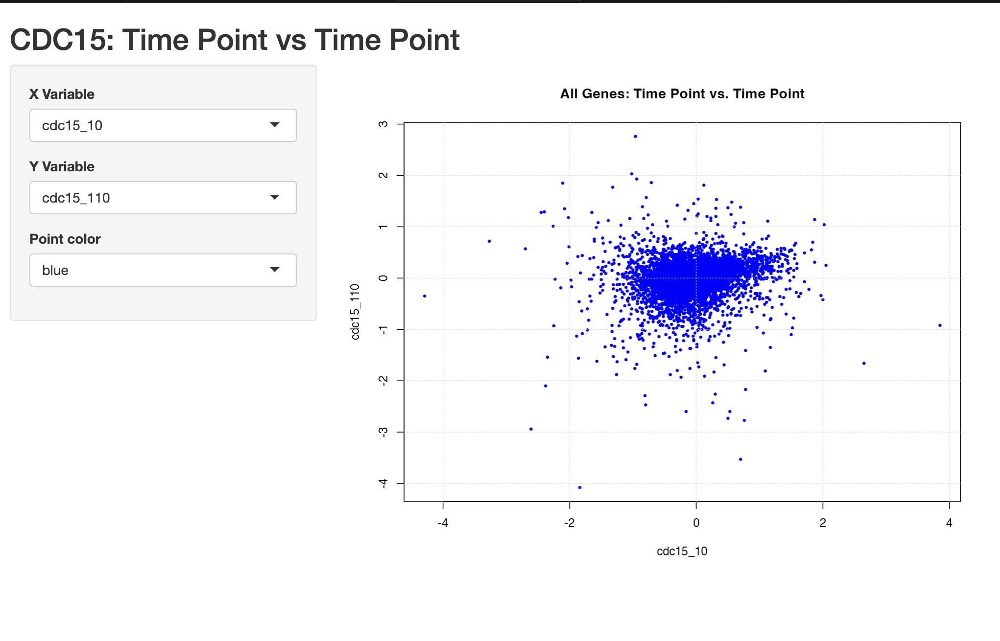

#### Dylan Renard  
#### Professor Brandon Higgs  
#### Gene Expression and Data Visualization  
#### Johns Hopkins University  
#### September 6th, 2025

# Lab 2:
In this lab, we are going to work with a very popular time course cDNA data set from Paul Spellman’s lab at Stanford.  This microarray was designed with probes from the yeast Saccharomyces cerevisiae genome.  The data set includes 3 different experiments, each with its own time course (each array is a different time point) for measuring transcript levels that are induced by various cyclins.  The transcripts that respond to this stimulus are seen to be regulated at the different stages of the cell cycle.  The 3 experiments differ by the method that the yeast cultures were synchronized: α factor arrest, elutriation, and arrest of a cdc15 temperature-sensitive mutant.  The cdc15 time course experiment is the one that we will use in this lab to conduct some simple mathematical manipulations and plots. 

The paper, “Comprehensive Identification of Cell Cycle–regulated Genes of the Yeast Saccharomyces cerevisiae by Microarray Hybridization” is available on the course website. 

## Q1) Data Setup and Loading appropriate libraries
```{r}
#| label: setup
# Load core library for visualization
library(ggplot2)
# Load gplots for colorpanel
library(gplots)

```

## Q2) Unzip the text file, and read into R
```{r}
data <- read.table("spellman.txt", header = TRUE, row.names = 1)
# Extract the first row
head(data, 1)
```

## Q3) Look at the dimensions of the data frame
and make sure that there are 6,178 genes and 77 arrays/sample. 
```{r}
dim(data)
```

## Q4) Isolate only the cdc15 experiment (samples 23-46).
```{r}
# Isolate the cdc15 experiment (columns 23 through 46)
cdc15 <- data[, 23:46]
head(cdc15, 1)
```

## Q5) Now calculate a correlation matrix between the time points (use Pearson’s correlation).  
Make sure to title the plot, label the axes, and provide a legend of the color gradient.  In the correlation calculation, make sure to use the argument ‘use’ and value=pairwise.complete.obs since all of these arrays have at least one missing value.
```{r, fig.width=10, fig.height=12}
## Q5) Correlation matrix
# 1) Correlation
cdc15_cor <- cor(cdc15, use = "pairwise.complete.obs", method = "pearson")

# 2) Tidy the matrix for ggplot (keep original ordering)
df <- as.data.frame(as.table(cdc15_cor))
names(df) <- c("y","x","r")
df$x <- factor(df$x, levels = colnames(cdc15_cor))
df$y <- factor(df$y, levels = rownames(cdc15_cor))

# 3) Heatmap with legend at bottom; colors: blue (low) → black (mid) → yellow (high)
ggplot(df, aes(x = x, y = y, fill = r)) +
  geom_tile() +
  coord_fixed() +                       # square cells
  scale_fill_gradient2(
    low = "blue", mid = "black", high = "yellow",
    midpoint = 0, limits = c(-1, 1), name = "Pearson correlation"
  ) +
  labs(
    title = "Correlation Matrix of CDC15 Time Points",
    x = NULL, y = NULL
  ) +
  theme_minimal(base_size = 14) +
  theme(
    legend.position = "bottom",
    legend.direction = "horizontal",
    # Make the legend a compact color bar
    legend.title = element_text(size = 12, margin = margin(r = 8)),
    legend.text  = element_text(size = 11),
    axis.text.x  = element_text(angle = 90, vjust = 0.5, hjust = 1, size = 11),
    axis.text.y  = element_text(size = 11),
    plot.title   = element_text(size = 18, face = "bold", hjust = 0.5),
    plot.margin  = margin(t = 10, r = 12, b = 10, l = 12)
  ) +
  guides(fill = guide_colorbar(
    barwidth = unit(14, "cm"),   # adjust to taste
    barheight = unit(0.5, "cm"),
    ticks = TRUE
  ))
```

### Interpretation:
The CDC15 correlation heatmap demonstrates that adjacent time points are highly correlated (r ≈ 0.8–1.0), consistent with gradual transcriptome changes as cells move through the cycle. Correlations weaken with increasing temporal distance, and early vs. late time points share little similarity (r ≈ 0.2–0.4). A few pairs show modest negative correlations (as low as –0.6), but these are rare, indicating that global expression programs shift incrementally rather than in direct opposition. Overall, the matrix captures the expected continuity and divergence of gene expression dynamics during CDC15 arrest–release synchronization.

## Q6) Select the gene YAL002W
which is VPS8, a membrane-binding component of the CORVET complex; involved in endosomal vesicle tethering and fusion in the endosome to vacuole protein targeting pathway.  Impute the missing values with the row mean (save as something).  Make sure to cast the gene to numeric. 
```{r}
## Q6) imputing missing VPS8 values with the mean
vps8 <- cdc15["YAL002W", ]
vps8 <- as.numeric(vps8)

# Which positions are NA?
which_na <- names(cdc15)[is.na(vps8)]
print(which_na)  # expect: cdc15_10, cdc15_30, cdc15_50, cdc15_190, cdc15_270, cdc15_290

# Row mean (NA-ignored)
vps8_mean <- mean(vps8, na.rm = TRUE)
print(vps8_mean) # ~ 0

#pre-Impute dataset
cdc15["YAL002W", ]
# Impute
vps8_imputed <- ifelse(is.na(vps8), vps8_mean, vps8)
stopifnot(!any(is.na(vps8_imputed)))
names(vps8_imputed) <- colnames(cdc15)  # keep labels for Q7

# Check result
vps8_imputed
```

### Interpretation: 
YAL002W (VPS8) contained 6 missing values at early and late time points (10, 30, 50, 190, 270, 290 minutes). These were replaced with the row mean (≈0), ensuring a complete series for downstream plotting. The low row mean suggests VPS8 expression remains relatively stable overall.

## Q7) Generate a profile plot of the same gene
Title the plot, label the axes, and on the x-axis, provide the time points only for each array (no “cdc15_” prefix) so we can visualize the transcript pattern over time.  Use lwd in the plot command (lwd=line width). 
```{r}
## Q7) Profile plot for YAL002W (VPS8) across CDC15 time points
tp <- as.numeric(gsub("^cdc15_", "", names(vps8_imputed)))

# Order values by time
o <- order(tp)
tp <- tp[o]
vps8_plot <- vps8_imputed[o]

# Identify which time points were imputed
na_idx <- names(vps8_imputed) %in% c("cdc15_10","cdc15_30","cdc15_50",
                                     "cdc15_190","cdc15_270","cdc15_290")
na_idx <- na_idx[o]  # reorder to match tp order

# Plot the full profile line
plot(tp, vps8_plot,
     type = "o", lwd = 2, pch = 16, col = "black",
     xlab = "Time (min)",
     ylab = "Expression (log2 ratio)",
     main = "YAL002W (VPS8) – CDC15 Time Course")

grid()

# Overlay imputed points in blue
points(tp[na_idx], vps8_plot[na_idx], col = "red", pch = 16, cex = 1.2)

# Add legend
legend("bottomright",
       legend = c("Observed", "Imputed Mean"),
       col = c("black", "red"), pch = 16, lwd = 2)
```

### Interpretation: 
The VPS8 (YAL002W) profile across the CDC15 time course remains near zero with modest fluctuations, showing no clear oscillatory pattern typical of cell-cycle–regulated genes. Six missing values at early and late time points (10, 30, 50, 190, 270, and 290 min) were imputed with the row mean and are highlighted in red, underscoring the stability of expression at these stages. Minor peaks at ~130–150 min and ~220 min are small in magnitude and most likely reflect experimental noise rather than biologically meaningful periodicity. This flat trajectory is consistent with VPS8’s established role in vesicle trafficking and endosomal sorting, functions that require steady expression rather than cyclical regulation by the cell cycle.

## Q8) Now let’s create a simple shiny app which allows the user to select and correlate any time point verse another time point across all genes. 
Now let’s create a simple shiny app which allows the user to select and correlate any time point verse another time point across all genes.

```{r}
############################################################
# Dylan Renard
# JHU Gene Expression Lab 2
# September 6th 2025
# Professor Brandon Higgs
#
# CDC15 Time Course Shiny App (Q8 on Lab 2)
#
# Description:
#   This application visualizes Spellman’s yeast cell cycle dataset
#   (CDC15 temperature-sensitive mutant arrest experiment).
#
# Features:
#   - Reads in spellman.txt and subsets the CDC15 arrays (23–46)
#   - Launches a Shiny web app with interactive controls:
#       * X Variable selector: pick any CDC15 time point
#       * Y Variable selector: pick any CDC15 time point
#       * Point Color selector: customize scatterplot aesthetics
#   - Generates scatter plots across all 6,178 yeast genes
#   - Drops missing values automatically (pairwise complete obs)
#
# Notes:
#   - Based on the Lecture 3 "iris dataset" Shiny demo,
#     but swaps iris columns for CDC15 experiment arrays
#   - Designed for exploratory correlation visualization
#   - No correlation statistics or p-values displayed
#
# Usage:
#   - Save this file as app.R in the same directory as spellman.txt
#   - Run in RStudio: click "Run App" OR use:
#         shiny::runApp("shinyApp.R")
#
# Source Data:
#   Spellman PT, et al. (1998). Comprehensive identification of
#   cell cycle–regulated genes of the yeast Saccharomyces cerevisiae
#   by microarray hybridization. Mol Biol Cell. 9:3273–3297.
############################################################


# ---- Load CDC15 data ----
# Assumes spellman.txt is in your working directory
spell <- read.table("spellman.txt",
                    header = TRUE, row.names = 1, check.names = FALSE,
                    sep = "", stringsAsFactors = FALSE)

# CDC15 experiment: arrays 23–46
dat <- as.matrix(spell[, 23:46])
storage.mode(dat) <- "double"

library(shiny)

# ---- UI ----
ui <- fluidPage(
  titlePanel("CDC15: Time Point vs Time Point"),
  sidebarLayout(
    sidebarPanel(
      selectInput('xcol', 
                  'X Variable', 
                  dimnames(dat)[[2]], 
                  selected = dimnames(dat)[[2]][1]),
      selectInput('ycol', 
                  'Y Variable', 
                  dimnames(dat)[[2]], selected = dimnames(dat)[[2]][2]),
      selectInput('ptcol', 'Point color',
                  choices = c("red", "blue", "black", "darkgreen", "orange"),
                  selected = "red")
    ),
    mainPanel(
      plotOutput('plot', height = "520px")
    )
  )
)

# ---- Server ----
server <- function(input, output) {

  selectedData <- reactive({
    d <- dat[, c(input$xcol, input$ycol), drop = FALSE]
    keep <- complete.cases(d[,1], d[,2])
    data.frame(x = as.numeric(d[keep, 1]),
               y = as.numeric(d[keep, 2]))
  })

  output$plot <- renderPlot({
    d <- selectedData()
    plot(d$x, d$y,
         pch = 16, cex = 0.6, col = input$ptcol,
         xlab = input$xcol, ylab = input$ycol,
         main = "All Genes: Time Point vs. Time Point")
    grid()
  })
}

# ---- Launch ----
# shinyApp(ui = ui, server = server)
```



## Sources:

::: {#refs}
Chang W, Cheng J, Allaire J, Sievert C, Schloerke B, Xie Y, Allen J,
  McPherson J, Dipert A, Borges B (2025). _shiny: Web Application
  Framework for R_. R package version 1.11.1,
  <https://CRAN.R-project.org/package=shiny>.

H. Wickham. ggplot2: Elegant Graphics for Data Analysis.  Springer-Verlag New York, 2016.

R Core Team (2025). R: A language and environment for statistical computing. R Foundation for Statistical Computing, Vienna, Austria. <https://www.R-project.org/>.

Spellman, P. T., Sherlock, G., Zhang, M. Q., Iyer, V. R., Anders, K., Eisen, M. B., Brown, P. O., Botstein, D., & Futcher, B. (1998). Comprehensive identification of cell cycle-regulated genes of the yeast Saccharomyces cerevisiae by microarray hybridization. Molecular biology of the cell, 9(12), 3273–3297. <https://doi.org/10.1091/mbc.9.12.3273>
:::